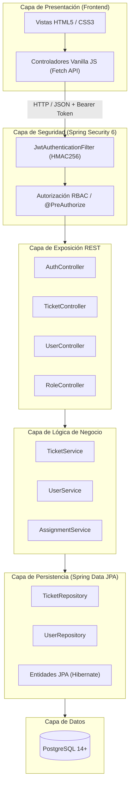
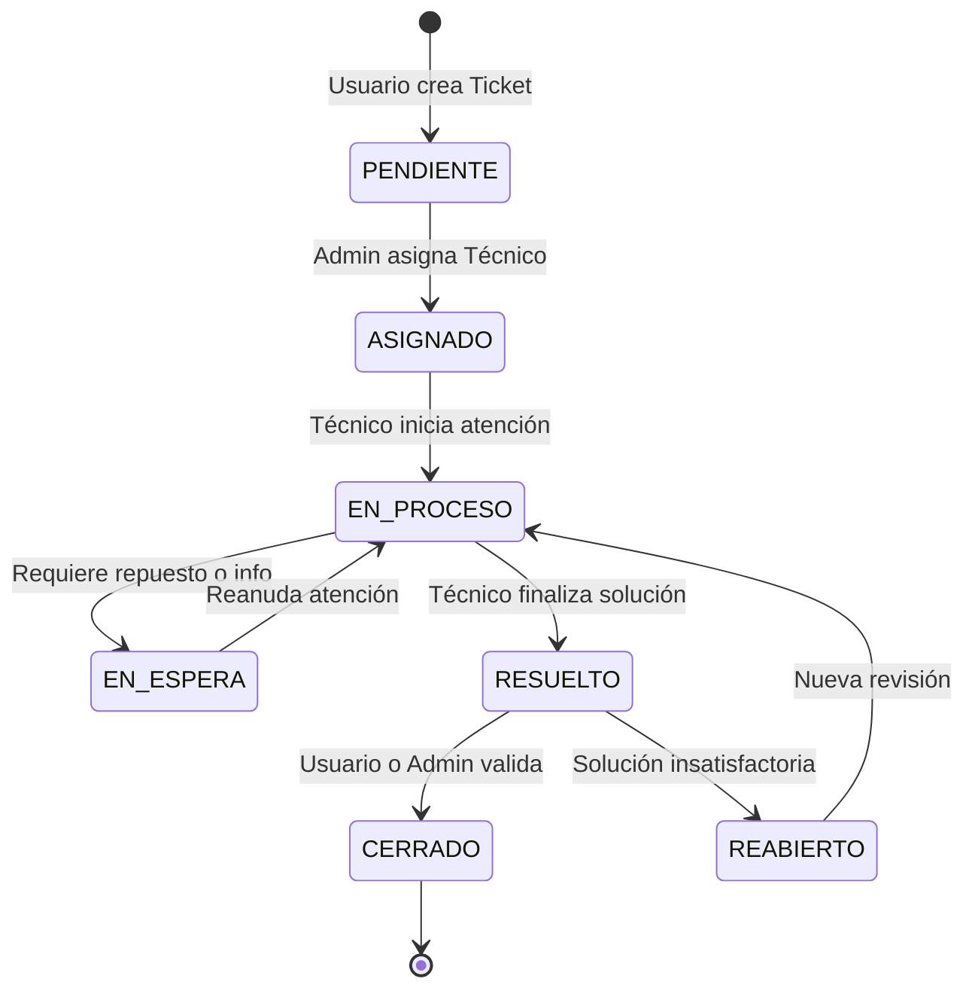

# 🎫 CAMPUSDESK — Plataforma de Mesa de Ayuda y Gestión de Tickets

<div align="center">

[](https://openjdk.org/)
[](https://spring.io/projects/spring-boot)
[](https://spring.io/projects/spring-security)
[](https://www.postgresql.org/)
[](https://jwt.io/)
[](http://localhost:8051/swagger-ui.html)
[](LICENSE)

**Sistema web integral para la recepción, priorización, asignación, seguimiento y resolución de incidencias técnicas en entornos de Campuslands.**

</div>

Sistema web integral para la recepción, priorización, asignación, seguimiento y resolución de incidencias y solicitudes técnicas en entornos institucionales o corporativos de campus. Diseñado con una arquitectura desacoplada y sin estado (*stateless*), incorpora control de acceso granular basado en roles (RBAC) con permisos dinámicos, ciclo de vida estricto para contraseñas y auditoría histórica completa de eventos.

---

## 👥 Integrantes del Proyecto

- **Sergio Aparicio**
- **Jhon Reyes**
- **Sebastian Ayala**
- **Juan Diego León**

---

## Creditos a:

- **Cristian Diaz** - Desarrollador de Software

---

## 🛠️ Tecnologías Utilizadas

### Backend
- **Lenguaje:** Java 21 LTS
- **Framework Principal:** Spring Boot 4.1.1
- **Seguridad:** Spring Security 6 (Filtros JWT simétricos HMAC256, arquitectura *stateless*, autorización granular mediante `@PreAuthorize`)
- **Persistencia y ORM:** Spring Data JPA / Hibernate (Generación y sincronización de esquema relacional con `ddl-auto=update`)
- **Gestor de Tokens:** Auth0 Java JWT (`java-jwt` v4.3.0)
- **Criptografía de Contraseñas:** BCrypt Password Encoder
- **Mapeo de Datos:** MapStruct 1.5.5.Final
- **Optimización de Código:** Project Lombok
- **Documentación Interactiva:** Springdoc OpenAPI Starter WebMvc UI 3.1.1 (Swagger UI / OpenAPI 3)
- **Construcción y Automatización:** Gradle 8.14.3 (vía Gradle Wrapper)
- **Pruebas:** Spring Boot Starter Test, Spring Security Test, JUnit 5 y base en memoria H2

### Frontend
- **Estructura:** HTML5 semántico
- **Estilos:** CSS3 moderno con variables CSS, diseño adaptativo (*responsive design*) y componentes modulares
- **Lógica del Cliente:** JavaScript ES6+ (Vanilla JS modular, Fetch API asíncrono, almacenamiento seguro de sesión mediante `sessionStorage`)
- **Diseño Gráfico e Iconografía:** SVGs optimizados y logotipos institucionales en alta fidelidad

### Base de Datos
- **Motor:** PostgreSQL 14 o superior
- **Pruebas Automatizadas:** Base de datos H2 en modo compatibilidad PostgreSQL

---

## 📋 Requisitos Previos

Antes de instalar y ejecutar el proyecto, asegúrate de contar con las siguientes herramientas instaladas y configuradas en tu sistema:

1. **Java Development Kit (JDK):** Versión 21 LTS instalada y referenciada en la variable de entorno `JAVA_HOME`.
   ```powershell
   java -version
   ```
2. **PostgreSQL:** Versión 14 o superior en ejecución sobre el puerto estándar `5432`.
   ```powershell
   psql --version
   ```
3. **Navegador Web Moderno:** Google Chrome, Microsoft Edge, Mozilla Firefox o Brave.
4. **Git:** Para clonar el repositorio y gestionar versiones de código.
5. **Servidor HTTP Local (Recomendado para Frontend):**
   - Extensión **Live Server** de Visual Studio Code, o
   - Python 3 (`python -m http.server`), o
   - Node.js (`npx serve`).

> [!NOTE]
> No es necesario tener Gradle instalado globalmente; el repositorio incluye los ejecutables del Gradle Wrapper (`gradlew` y `gradlew.bat`).
> El frontend está desarrollado en JavaScript Vanilla nativo, por lo que no requiere Node.js, `npm install` ni procesos de compilación o transpilación.

---

## 📦 Instrucciones de Instalación

### 1. Clonar el Repositorio
Abre tu terminal y clona el proyecto en tu espacio de trabajo local:

```bash
git clone https://github.com/Sergioandresaparicio/CAMPUSDESK.git
cd CAMPUSDESK
```

### 2. Estructura de Directorios del Repositorio
```text
CAMPUSDESK/
├── README.md                                # Documentación general del proyecto (este archivo)
├── spring-security-user-role-management/    # Código fuente del Backend (Spring Boot + Java 21)
│   ├── build.gradle                         # Dependencias y configuración de compilación
│   ├── gradlew / gradlew.bat                # Wrapper de Gradle (Linux/macOS y Windows)
│   ├── README.md                            # Documentación técnica extendida del backend
│   └── src/
│       ├── main/java/com/roles/usermanagement/
│       │   ├── domain/                      # Modelos, DTOs y lógica transversal
│       │   ├── modules/                     # Módulos de soporte (ticket, assignment, etc.)
│       │   ├── persistance/                 # Entidades JPA, repositorios y mappers
│       │   └── web/                         # Controladores REST, filtros y configuración
│       └── main/resources/
│           ├── application.properties       # Perfil activo por defecto (dev)
│           └── application-dev.properties   # Parámetros de conexión a BD y JWT
└── Frontend/                                # Código fuente del Frontend (HTML, CSS y JS)
    ├── Assets/                              # Iconos vectoriales e imágenes estáticas
    ├── Scripts/                             # Módulos JS, configuración de API y controladores
    ├── stylesheet/                          # Hojas de estilo CSS modularizadas
    ├── index.html                           # Vista de inicio de sesión y cambio de clave
    ├── superadmin.html                      # Panel de administración de usuarios y roles
    ├── technician.html                      # Panel para técnicos con tickets asignados
    ├── user.html                            # Panel de inicio para usuarios solicitantes
    ├── create-ticket.html                   # Formulario de radicación de incidencias
    ├── my-tickets.html                      # Seguimiento de tickets propios
    ├── ticketlist.html                      # Vista general y filtrado de tickets
    └── assignation.html                     # Gestión y reasignación de personal técnico
```

---

## 🗄️ Instrucciones para Preparar PostgreSQL

### 1. Iniciar el Servicio de PostgreSQL
Verifica que el servicio de PostgreSQL esté activo en tu máquina local.

### 2. Crear la Base de Datos
Accede a PostgreSQL mediante pgAdmin o la consola `psql` con un usuario con privilegios de creación (por ejemplo, el usuario `postgres` o `admin`) y ejecuta:

```sql
CREATE DATABASE "campusDESK";
```

*(Si prefieres nombres en minúsculas sin comillas, puedes crear `CREATE DATABASE campusdesk;` y ajustar la variable `DB_URL` convenientemente).*

### 3. Generación y Sincronización Automática de Tablas
El backend utiliza Hibernate con la propiedad:
```properties
spring.jpa.hibernate.ddl-auto=update
spring.jpa.properties.hibernate.auto_quote_keyword=true
```
Al arrancar la aplicación por primera vez, el sistema creará automáticamente todas las tablas relacionales (`user`, `role`, `permission`, `user_role`, `ticket`, `ticket_assignment_log`, `technician_profile`, `status_history`, `comment`, `lifecycle_rule`, etc.).

### 4. Inicialización Automática de Datos (Bootstrap)
Al completarse el inicio del backend, el servicio `SecurityBootstrapService`:
- Crea automáticamente los permisos base del sistema (`USER_READ`, `TICKET_CREATE`, `TICKET_ASSIGN`, etc.).
- Registra los roles por defecto (`ADMIN`, `TECHNICIAN`, `USER`) y asocia sus permisos correspondientes.
- Crea el Super Administrador inicial (por defecto usuario `superadmin`), listo para iniciar sesión.

---

## ⚙️ Configuración mediante Variables de Entorno

El backend lee su configuración del archivo `spring-security-user-role-management/src/main/resources/application-dev.properties`. Todas las variables cuentan con valores predeterminados para desarrollo local y pueden ser sobrescritas mediante variables de entorno del sistema operativo:

| Variable de Entorno | Descripción | Valor Predeterminado en Dev |
|---|---|---|
| `DB_URL` | URL JDBC de conexión a PostgreSQL | `jdbc:postgresql://localhost:5432/campusDESK` |
| `DB_USERNAME` | Usuario para conectarse a PostgreSQL | `admin` |
| `DB_PASSWORD` | Contraseña del usuario de PostgreSQL | `admin123` |
| `JWT_SECRET` | Clave secreta para la firma HMAC256 de los tokens JWT | `0fb5a8994cde705e2f45ca46921f00bffa60fdcb17ee9eecbcfed06574fa38d7` |
| `JWT_ISSUER` | Emisor registrado en el claim `iss` del token JWT | `0fb5a8994cde705e2f45ca46921f00bffa60fdcb17ee9eecbcfed06574fa38d7` |
| `JWT_EXPIRATION` | Vigencia del token (`30m`, `8h`, `15d` o formato ISO-8601) | `15d` |
| `ADMIN_USERNAME` | Nombre de usuario del Super Administrador inicial | `superadmin` |
| `ADMIN_EMAIL` | Correo electrónico del Super Administrador inicial | `superadmin@localhost` |
| `ADMIN_PASSWORD` | Contraseña provisional del Super Administrador | `SuperAdmin123!` |
| `BOOTSTRAP_ADMIN_ENABLED`| Activa la creación de roles, permisos y usuario inicial | `true` |

### Configuración del Frontend
La URL base del backend que consume el cliente web se encuentra centralizada en:
`Frontend/Scripts/config/api.config.js`:
```javascript
export const API_BASE_URL = "http://localhost:8051";
export const TOKEN_STORAGE_KEY = "authToken";
```
Si ejecutas el backend en un puerto o dominio diferente, actualiza la constante `API_BASE_URL`.

---

## 🚀 Procedimiento de Ejecución del Backend y Frontend

### 1. Ejecución del Backend (Spring Boot)

#### En Windows (PowerShell):
Abre una consola PowerShell, sitúate en la carpeta del backend y define tus credenciales de PostgreSQL:

```powershell
cd spring-security-user-role-management

# Opcional: define tus credenciales de PostgreSQL si difieren del archivo properties
$env:DB_URL = "jdbc:postgresql://localhost:5432/campusDESK"
$env:DB_USERNAME = "postgres"
$env:DB_PASSWORD = "tu_password_de_postgres"

# Iniciar la aplicación
.\gradlew.bat bootRun
```

#### En Linux o macOS (Bash):
```bash
cd spring-security-user-role-management

export DB_URL="jdbc:postgresql://localhost:5432/campusDESK"
export DB_USERNAME="postgres"
export DB_PASSWORD="tu_password_de_postgres"

./gradlew bootRun
```

#### Generación del Archivo `.jar` Autónomo:
Para empaquetar y ejecutar en modo producción:
```powershell
.\gradlew.bat clean bootJar
java -jar build/libs/usermanagement-0.0.1-SNAPSHOT.jar
```

El servidor estará escuchando y listo para recibir peticiones en:
👉 **`http://localhost:8051`**

---

### 2. Ejecución del Frontend

Para garantizar el correcto funcionamiento de los módulos JavaScript (`import` / `export`), se recomienda servir la carpeta `Frontend` mediante un servidor web local:

#### Opción A: Usando Python (Cualquier Sistema Operativo)
Abre una segunda terminal y ejecuta:
```powershell
cd Frontend
python -m http.server 5500 --bind 127.0.0.1
```
Luego accede desde tu navegador a:
👉 **`http://127.0.0.1:5500`**

#### Opción B: Usando Live Server (Visual Studio Code)
1. Abre la carpeta `Frontend` en Visual Studio Code.
2. Haz clic derecho sobre el archivo `index.html`.
3. Selecciona **"Open with Live Server"**.

#### Opción C: Usando Node.js / `serve`
```bash
npx serve -l 5500 Frontend
```

---

## 🔐 Descripción de Roles y Permisos

CAMPUSDESK implementa un modelo de control de acceso híbrido que combina **Role-Based Access Control (RBAC)** con **Permisos Individuales Dinámicos**. Los permisos efectivos de una sesión son el resultado de la unión entre las facultades heredadas por el rol asignado y los permisos individuales concedidos a la cuenta:

$$\text{Permisos Efectivos} = \text{Permisos del Rol} \cup \text{Permisos Individuales}$$

### 1. Matriz de Roles Principales

| Rol | Destinatario | Funciones y Responsabilidades |
|---|---|---|
| `ADMIN` | Administradores de TI y Coordinadores | Acceso total al sistema: gestión de cuentas de usuario (alta, baja, bloqueo, reseteo de claves), asignación de roles y permisos, visualización de todos los tickets (`TICKET_READ_ALL`), asignación de técnicos a tickets (`TICKET_ASSIGN`) y acceso a métricas globales del dashboard (`REPORT_READ`). |
| `TECHNICIAN` | Personal de Soporte Técnico | Atención operativa de incidentes: consulta de tickets asignados (`TICKET_READ_ASSIGNED`), avance en la máquina de estados del ciclo de vida (`TICKET_STATUS_UPDATE`), publicación y lectura de comentarios técnicos (`COMMENT_CREATE`, `COMMENT_READ`) y auditoría de cambios de estado (`HISTORY_READ`). |
| `USER` | Requerientes (Estudiantes, Docentes, Empleados) | Autogestión de requerimientos: radicación de nuevos tickets (`TICKET_CREATE`), seguimiento de solicitudes propias (`TICKET_READ_OWN`, `TICKET_UPDATE_OWN`), confirmación o cierre de ticket resuelto (`TICKET_CLOSE`) e interacción mediante comentarios. |

### 2. Flujo de Seguridad y Ciclo de Vida de Contraseñas

```text
[ Super Admin crea Usuario ]
          │
          ▼  mustChangePassword = true (contraseña temporal)
[ Primer Login del Usuario (/api/auth/login) ]
          │
          ▼  Respuesta: { token, mustChangePassword: true }
[ Frontend bloquea navegación y abre Modal Forzoso de Cambio de Clave ]
          │
          ▼  POST /api/auth/change-password
[ Backend valida, encripta nueva clave en BCrypt y apaga la bandera ]
          │
          ▼
[ Acceso autorizado al Dashboard según el Rol ]
```

---

## 📖 Enlace Local para Consultar Swagger

La API de CAMPUSDESK cuenta con documentación interactiva generada con OpenAPI 3 y Swagger UI:

- 🌐 **Swagger UI (Pruebas interactivas):**  
  [http://localhost:8051/swagger-ui.html](http://localhost:8051/swagger-ui.html)  
  *(o [http://localhost:8051/swagger-ui/index.html](http://localhost:8051/swagger-ui/index.html))*

- 📄 **Especificación OpenAPI (JSON):**  
  [http://localhost:8051/v3/api-docs](http://localhost:8051/v3/api-docs)

### Procedimiento para Probar Endpoints Protegidos en Swagger UI:
1. Abre [Swagger UI](http://localhost:8051/swagger-ui.html) en tu navegador.
2. Despliega la sección `auth-controller` y ejecuta el endpoint `POST /api/auth/login` con tus credenciales:
   ```json
   {
     "username": "superadmin",
     "password": "SuperAdmin123!"
   }
   ```
3. Copia el valor de la propiedad `token` que retorna la respuesta.
4. En la parte superior derecha de la interfaz de Swagger UI, haz clic en el botón verde **Authorize**.
5. Pega el token JWT en el campo de texto (sin escribir la palabra `Bearer`).
6. Presiona **Authorize** y luego **Close**. A partir de este momento, todas las peticiones que pruebes incluirán automáticamente el encabezado `Authorization: Bearer <token>`.

---

## 📸 Evidencias de Funcionamiento

A continuación se resumen los módulos verificados y las vistas funcionales que componen la plataforma CAMPUSDESK:

### 1. Vistas y Módulos de la Interfaz Web (Frontend)

| Pantalla / Archivo | Rol Destinado | Funcionalidad Clave |
|---|---|---|
| **Inicio de Sesión** (`index.html`) | Público / Todos | Autenticación mediante usuario o correo, validación de estado de cuenta y modal forzoso de cambio de contraseña ante primer acceso. |
| **Panel de Super Administrador** (`superadmin.html`) | `ADMIN` | Visualización de indicadores clave, métricas de tickets en tiempo real y accesos rápidos a administración. |
| **Administración de Usuarios** (`userlist.html` y `newuser.html`) | `ADMIN` | Catálogo de usuarios registrados, alta con contraseña temporal, bloqueo/desbloqueo, edición y restablecimiento de contraseña. |
| **Selector de Roles y Permisos** (`roleselector.html`) | `ADMIN` | Asignación y revocación dinámica de roles y permisos individuales a usuarios. |
| **Asignación de Tickets** (`assignation.html`) | `ADMIN` | Asignación de requerimientos a operadores técnicos según especialidad y carga de trabajo. |
| **Panel de Soporte Técnico** (`technician.html`) | `TECHNICIAN` | Listado de tickets asignados, transición de estados del ciclo de vida (`EN_PROCESO`, `RESUELTO`, etc.) y bitácora de comentarios. |
| **Catálogo de Técnicos** (`techguys.html`) | `ADMIN` / `TECHNICIAN` | Perfiles de operadores técnicos y consulta de especialidades. |
| **Portal de Solicitante** (`user.html`) | `USER` | Panel de bienvenida para el usuario con accesos a reportar incidentes y ver el estado de sus casos. |
| **Creación de Ticket** (`create-ticket.html`) | `USER` / `ADMIN` | Formulario para reportar incidentes con título, descripción detallada, categoría y nivel de prioridad. |
| **Mis Solicitudes** (`my-tickets.html`) | `USER` | Trazabilidad de tickets creados por el usuario con visualización de estado actual y respuestas de soporte. |
| **Listado General de Tickets** (`ticketlist.html`) | `ADMIN` / `TECHNICIAN` | Tabla integral de tickets con filtros por estado, prioridad, solicitante y fecha de creación. |


### 2. Credenciales Iniciales de Prueba

| Usuario | Contraseña Inicial | Rol Asignado | Propósito |
|---|---|---|---|
| `superadmin` | `SuperAdmin123!` | `ADMIN` | Administración global, gestión de usuarios, roles y asignaciones. |

### 3. Verificación y Pruebas Automatizadas del Backend
El backend incluye una suite de pruebas de integración con base de datos H2 en memoria que valida la seguridad, los flujos de autenticación, ciclo de vida de tickets y autorización granular:

```powershell
cd spring-security-user-role-management
.\gradlew.bat test
```
Resultados de ejecución esperados:
- **Pruebas de Seguridad:** Validación de emisión y firma de tokens JWT HMAC256, expiración y rechazo de accesos no autorizados (HTTP 401/403).
- **Pruebas de Ciclo de Vida:** Comprobación de transiciones de estado válidas e invalidación de saltos ilegales en tickets.
- **Pruebas de Concurrencia y Transacciones:** Verificación de atomicidad en asignaciones y cambios de estado con rollback automático en caso de excepción.

---

## 🏛️ Arquitectura de Software y Principios SOLID

El sistema implementa una arquitectura en capas desacoplada con estricta adherencia a los estándares de ingeniería de software:



### Aplicación de Principios SOLID

1. **Single Responsibility Principle (SRP):**
   * Cada controlador (`AuthController`, `TicketController`) se limita a manejar el transporte HTTP y serialización.
   * La lógica de negocio reside exclusivamente en los servicios (`TicketService`, `UserService`).
   * La persistencia está aislada en repositorios JPA dedicados.
2. **Open/Closed Principle (OCP):**
   * El sistema de filtros de seguridad y la jerarquía de roles admiten nuevos tipos de permisos y filtros sin modificar el núcleo de autenticación.
3. **Liskov Substitution Principle (LSP):**
   * Los repositorios extienden `JpaRepository<T, ID>`, permitiendo sustitución transparente y pruebas unitarias con mocks o bases de datos en memoria (H2).
4. **Interface Segregation Principle (ISP):**
   * DTOs específicos para cada operación (`TicketCreateRequest`, `TicketResponseDTO`, `UserUpdateRequest`) evitando transferir campos innecesarios o acoplar la vista a la entidad JPA.
5. **Dependency Inversion Principle (DIP):**
   * Los controladores y servicios dependen de abstracciones (interfaces de repositorios y servicios), inyectadas mediante el contenedor IoC de Spring (`@Autowired` / inyección por constructor).

### Ciclo de Vida del Ticket (Máquina de Estados)



---

## 🤝 Metodología Ágil, Scrum y Flujo Colaborativo

El proyecto fue desarrollado simulando un entorno profesional de desarrollo ágil con la metodología **Scrum**:

* **Sprint Planning & Backlog:** Definición de historias de usuario con criterios de aceptación (Gherkin format: *Dado, Cuando, Entonces*).
* **Roles en el Equipo:**
  * **Sergio Aparicio:** Arquitectura backend, diseño de la base de datos PostgreSQL, integración de Spring Security y endpoints de tickets.
  * **Jhon Reyes / Sebastian Ayala / Juan Diego León:** Desarrollo de módulos de frontend, integración de consumo de API y suite de pruebas.
* **Flujo de Ramas (Gitflow):**
  * `main`: Código estable y listo para producción.
  * `develop`: Integración continua de funcionalidades.
  * `feature/*`: Desarrollo de módulos específicos (ej. `feature/ticket-lifecycle`, `feature/auth-jwt`).
* **Conventional Commits:** Adopción obligatoria de prefijos semánticos (`feat:`, `fix:`, `docs:`, `refactor:`, `test:`) para garantizar un changelog automatizable.

---

## 📄 Licencia

Este proyecto está bajo la Licencia **MIT**. Consulta el archivo [LICENSE](LICENSE) para mayores detalles.
